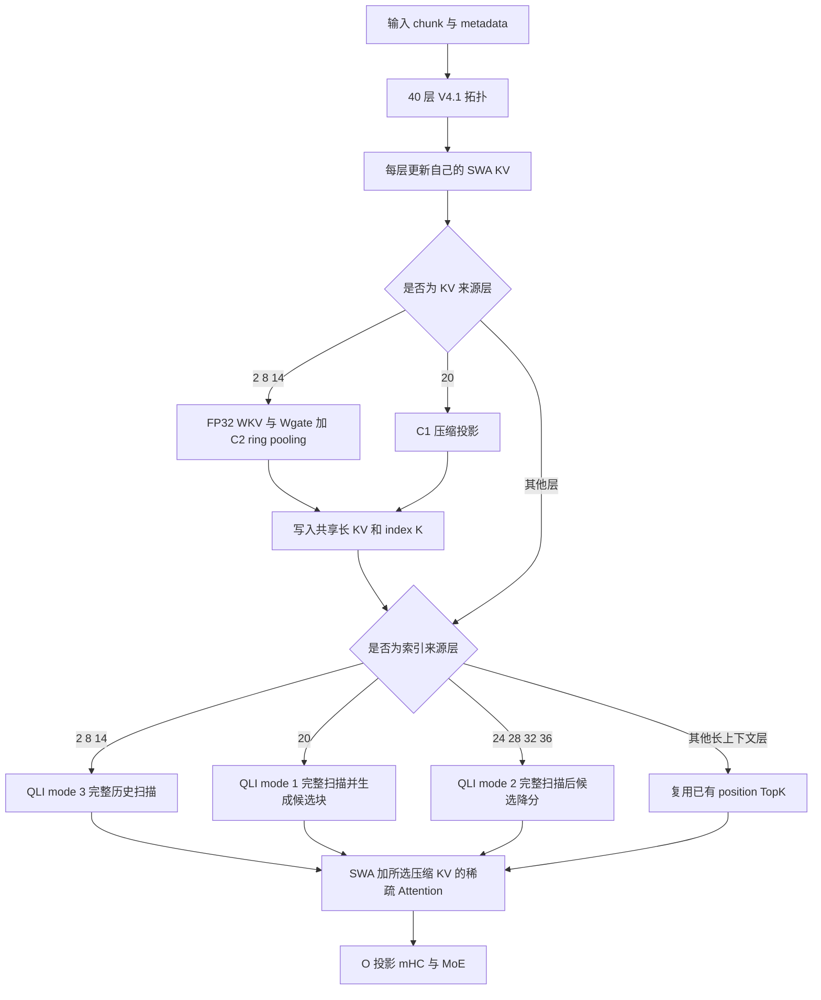

# DeepSeek V4.1 Flash 长输入支持与性能分析

本文分析本地 `releases/v0.31.0rc` 分支、提交 `e099a085329b57cb62b8eee4d381c70c3db2566b`，日期为 2026 年 10 月 24 日。分析对象是当前 Ascend 实现的执行逻辑，重点是 A2/A3 的 64K 和 128K 纯文本输入。64K 精确定义为 65,536 token，128K 为 131,072 token。

**结论：A2/A3 路径存在已经由源码执行和仿真确认的长上下文计算冗余及缓存页填充开销。候选消费者仍计算完整历史 QK；输入翻倍时，冷预填充的索引逻辑 QK 计算量接近四倍。Decoder bounded replay 能显著减少后 19 层的执行行数，但当前 PCP 路径会关闭它。**

本文不把计算量倍数换算成端到端时延倍数。此次执行环境是 macOS ARM64 CPU，没有运行 NPU、完整模型权重、HCCL 或在线服务。因此，TTFT、TPOT、吞吐、NPU 实际峰值显存及模型质量的数值均未测得；不能宣称已经测得服务超时、吞吐回退或某个百分比的 NPU 加速。本文给出的数值分别是实际执行的控制流计数、源码布局字节数和数值参考实验结果。

**2026-10-24 后续研究补充：** [论文与 GitHub 评估](deepseek_v41_2026_research_zh.md)核实了公开原版 checkpoint 的关键拓扑与本实验一致，并确认 bounded replay 相对完整 prefill 是近似 SWA 重建。本文 replay 工作量数字不能解释为无损收益；后续新增的两层 SWA 反例、Top-K 精度契约及 DSpark 预算源码实验见新报告。

配套文件：

- [技术特性报告](/Users/loki.yao/vllm-ascend/docs/source/developer_guide/deepseek_v41_long_context_features_zh.md)
- [仿真程序](/Users/loki.yao/vllm-ascend/benchmarks/deepseek_v41_long_context/simulate.py)
- [原始结果及源码 SHA256](/Users/loki.yao/vllm-ascend/benchmarks/deepseek_v41_long_context/results/results.json)
- [实际断点输出](/Users/loki.yao/vllm-ascend/benchmarks/deepseek_v41_long_context/results/breakpoints.txt)

## 1 分析配置与证据范围

当前工作区未提供部署 checkpoint 的 `config.json`、权重及服务启动参数。实验没有把网上的模型规格或另一代 DeepSeek 的参数替代为本地配置，而是执行本仓库 V4.1 的 40 层拓扑测试配置，配合仓库缓存测试中的正式维度。以下结论对表中配置成立；同名模型若改变这些参数，应重新运行实验。

| 参数 | 实验值 | 本地依据 |
| --- | --- | --- |
| Backbone 层数 | 40 | `test_deepseek_v41_layer_plan.py:text_config` |
| 压缩比 | 前 2 层为 0，随后 18 层为 2，末 20 层为 1 | 同上；忽略附加 speculative 层配置 |
| KV 来源层 | 2、8、14、20 | 同上 |
| 索引来源层 | 2、8、14、20、24、28、32、36 | 同上 |
| 候选来源层 | 20 | 同上 |
| 候选块数量及块大小 | 2,048 × 8 | 同上 |
| Position TopK | 512 | 同上 |
| SWA 窗口 | 128 | `tests/deepseek_v41_utils.py:make_cache_config` |
| KV / index head dimension | 512 / 128 | 同上 |
| 逻辑 block size | 128 | 同上及 MRV2 E2E 配置 |
| 主分析 chunk | 8,192 | MRV2 E2E 配置 |
| Engram 层位置 | 1、14 | 拓扑测试；未执行 Engram 权重查询 |
| 索引头数 | 数值实验 32；算术结果同时提供 32、64 | A2/A3 算子接受的两个值，未认定 checkpoint 使用哪一个 |

证据分为三个等级，原始 JSON 不包含用 CPU 时间推算出的 NPU 时间：

1. **原函数执行**：通过 AST 提取并执行 `build_layer_plan`、`get_layer_tuples`、`make_decoder_replay`、`DecoderReplayState.prepare`、`select_projected`、`_select_sparse_indices`。函数体不重写；设备对象用明确的形状及调用记录对象替代。
2. **原 C++ 调度体执行**：提取 `GetS2BaseBlockNumOnMask` 和 `ProcessBaseBlock`，编译为 CPU 程序；矩阵乘、Vector 处理和设备同步替换为计数器。原始分支与循环调度函数体保留。它验证调用次数，不执行 Ascend 指令或模拟流水线耗时。
3. **NumPy 数值参考**：按仓库 INT8 golden 的量化、ReLU、FP16 权重、FP32 累加、候选排序逻辑比较全扫描与紧凑候选路径。它检验指定数据上的数学语义，不替代 NPU 算子一致性或完整模型质量评测。

## 2 当前支持情况

### 2.1 模型入口与运行环境

`DeepseekV41ForCausalLM` 注册到 Ascend 的多模态包装类，再进入 V4.1 LLM 和独立的 V4.1 attention 实现。`DeepseekV41DSparkModel` 有独立注册。它们不是 V4 类名的别名。[注册入口](/Users/loki.yao/vllm-ascend/vllm_ascend/models/__init__.py:38)、[多模态包装](/Users/loki.yao/vllm-ascend/vllm_ascend/models/deepseek_v41/vl_model.py:44)

代码依赖匹配版本的上游 `vllm.models.deepseek_v41`、V4.1 配置、tokenizer 和 renderer。本分支 `.github/vllm-release-tag.commit` 为 `v0.31.0`。仅安装本仓库而缺少这些上游模块，不构成可启动环境。本次 CPU 实验通过隔离提取函数执行，不伪造完整模型加载成功。

| 能力 | 当前源码行为 | 本次证据 |
| --- | --- | --- |
| A2/A3 W8A8 服务 | 有模型注册、Ascend 量化接入及 P/D 配置 | 源码及 YAML 存在；未运行权重推理 |
| A2/A3 长 KV 与索引 | 长 KV 为 BF16；索引 K 为 INT8，scale 为 FP16 | 缓存规格函数及分配逻辑 |
| A5 | 走独立 packed cache 和 DSL QLI/QSLI/MQSMLA；SWA 为 MXFP8 布局，压缩 KV 为 FP4 布局 | 分支及 ABI 已确认；不套用 A2/A3 内核结论 |
| A5 Model Runner | 强制 MRV2，V1 抛异常 | `platform.py:_validate_model_runner_config` |
| MRV1 DSA CP | 有按 TP token 分片的适配器 | `AscendDSAV41CPImpl` |
| MRV2 PCP | 有本地 query、全局复制缓存的适配器 | `AscendDSAV41PCPImpl`；存在 PCP4 E2E 配置 |
| MRV2 与旧 DSA CP 同开 | 明确拒绝 | `ascend_config.py:717` 抛 `ValueError` |
| PCP 与 DCP 叠加 | V4.1 PCP 要求 DCP=1 | PCP metadata builder 抛 `NotImplementedError` |
| Engram | 有 CPU UVA、INT8 存储及共享内存路径；要求 TP=1/2/4/8 且 PP=DCP=1 | `platform.py:_validate_engram_config` |
| Decoder replay | 已实现；受拓扑、图模式、日志需求、调度器和并行方式限制 | 原函数执行与后文条件矩阵 |
| DSpark | 有 draft 实现及 target hidden state 接口 | 未测接受率；不将生成侧收益计入冷 prefill |
| 图像输入 | 有 ViT、aligner 和图像 span 处理 | 本次工作量矩阵只包含文本 token |
| PP / LoRA / Eagle3 接口 | 类声明相应接口 | 不能据此宣称所有组合可运行；Engram 与 replay 有明确限制 |

硬件分支依据：[cache_config.py](/Users/loki.yao/vllm-ascend/vllm_ascend/models/deepseek_v41/cache_config.py:45)、[hardware_profile.py](/Users/loki.yao/vllm-ascend/vllm_ascend/device/hardware_profile.py:338)、[mixed_quant_attention.py](/Users/loki.yao/vllm-ascend/vllm_ascend/models/deepseek_v41/mixed_quant_attention.py:104)。并行与 Engram 条件依据：[ascend_config.py](/Users/loki.yao/vllm-ascend/vllm_ascend/ascend_config.py:711)、[platform.py](/Users/loki.yao/vllm-ascend/vllm_ascend/platform.py:1768)。

### 2.2 仓库文档与源码的差异

部署教程仍写“仅支持 Model Runner V1”，但当前源码已有 MRV2 V4.1 集成，MRV2 P/D YAML 明确设置 `VLLM_USE_V2_MODEL_RUNNER=1`。该教程不能作为当前分支 MRV2 支持范围的判断依据。

教程介绍的 FP4 KV、890 bytes/token，也不能直接作为当前 A2/A3 这条 BF16 KV 路径的实际缓存预算。本报告按实际 cache spec 和 allocator 计算字节数。

仓库确有 128K、90% prefix 的性能测试配置，但配置文件中的 `baseline` 和 `threshold` 是测试输入，不是本次运行的测量结果。`deepseek_v41_qli_candidate.md` 记录的 20,032-token 测试范围也仅属于该记录对应的测试，不覆盖本分支所有已有测试配置。[部署教程](/Users/loki.yao/vllm-ascend/docs/source/tutorials/models/DeepSeek-V4.1-Flash.md:45)、[MRV2 测试配置](/Users/loki.yao/vllm-ascend/tests/e2e/cases/models/configs/DeepSeek/DeepSeek-V4.1-Flash-w8a8-PD-MRV2.yaml:1)

## 3 一次前向中的实际执行路径



实际执行 `_select_sparse_indices` 和 `select_projected` 得到的模式序列是 `3,3,3,1,2,2,2,2`，每个完整前向有 8 次 indexer 调用，而不是 38 次。其余 30 个长上下文层复用 position TopK；前 2 层没有长上下文索引。[源码入口](/Users/loki.yao/vllm-ascend/vllm_ascend/attention/dsa_v41.py:620)

C2 来源层只有 2、8、14，C1 来源层只有 20。KV 共享与 TopK 共享已经存在，不能把“跨层共享 KV/TopK”再次列为尚未实现的优化。

## 4 已确认的问题一 候选消费者仍完整计算历史 QK

### 4.1 源码因果链

1. `select_projected` 把候选消费者映射到 `candidate_mode=2`，调用 `npu_quant_lightning_indexer_v3`；Torch binding 指向 `QuantLightningIndexerCandidate`。
2. A2/A3 `GetS2BaseBlockNumOnMask` 按当前 query 的因果可见长度计算 S2 tile 数，固定 query group=4，S2 tile=2,048。函数不读候选集合。
3. `ProcessMain` 遍历这些 S2 tile；`ProcessBaseBlock` 在有效 tile 上调用 `ComputeMm1`，没有候选块跳过条件。
4. Cube 通过 block table 读取完整历史对应的 K 分段。
5. `ProcessVec1` 读取 QK 结果、乘 K scale 后，才执行 `BuildCandidateMask`，将候选外 score 降到有限负数，再做排序与 TopK 合并。

直接证据：[indexer.py:277](/Users/loki.yao/vllm-ascend/vllm_ascend/models/deepseek_v41/indexer.py:277)、[调度与 Cube 调用](/Users/loki.yao/vllm-ascend/csrc/attention/quant_lightning_indexer_v2/op_kernel/arch22/quant_lightning_indexer_v2_kernel_arch22.h:318)、[候选降分发生位置](/Users/loki.yao/vllm-ascend/csrc/attention/quant_lightning_indexer_v2/op_kernel/arch22/quant_lightning_indexer_v2_service_vector_arch22.h:846)。

**因此：候选块限制了排序资格，未限制当前 A2/A3 消费者的 QK 扫描长度。128K 时，把消费者的计算量按 16K 计算是错误的。** A5 调用独立的 sparse indexer，本文未将这个结论推广到 A5。

### 4.2 64K 和 128K 的可复现计数

定义一个“逻辑 QK 对”为某个索引来源层内，一条 query 与一个因果可见压缩 K 位置的配对，不含 head 和 dimension。没有 replay 时：

```text
P(N) = 3 × Σ[t=1..N] floor(t/2) + 5 × Σ[t=1..N] t
N 为偶数时：P(N) = 13N²/4 + 5N/2
```

| 冷输入与 chunk=8192 | 64K | 128K |
| --- | ---: | ---: |
| prefill 调度步数 | 8 | 16 |
| 完整 40 层执行 token 行数 | 2,621,440 | 5,242,880 |
| 逻辑 QK 对数 | 13,958,807,552 | 55,834,902,528 |
| 原 C++ 调度体的 Cube 调用次数 | 1,769,472 | 6,946,816 |
| 32 index heads、dim=128 的逻辑 QK 整数运算数 | 114,350,551,465,984 | 457,399,521,509,376 |
| 64 index heads、dim=128 的逻辑 QK 整数运算数 | 228,701,102,931,968 | 914,799,043,018,752 |

整数运算数按每个 multiply-add 计 2 次，只用于比较逻辑工作量。C++ 调用数包括 query group 共用可见上界的实际调度；不包含 Cube 内部 padding、每核划分额外搬运、FP16 头归约、sort、MoE 和通信。两类数字不是同一个指标。

这里按完整 query 集合的一个索引副本计数。普通 TP 的 index heads 使用 `ReplicatedLinear`，不能把这份计数自动除以 TP；DSA CP/PCP 按 query 分片时，需按各 rank 实际 query 行重新统计，不能把本表直接称作某个 rank 的实测工作量。

64K 到 128K，逻辑 QK 对数接近 4 倍，Cube tile 调用数为 3.9259 倍。此次没有发现“恰好跨过 64K 或 128K 时才切换到另一条低效路径”的证据；已执行的邻界探针表现为既有因果扫描及 tile 取整增长。不能从这里推出硬件调度不会出现其他时延拐点。

### 4.3 Decode 同样不具有固定索引成本

下表上下文长度包含当前 token；无 DSpark 额外验证行。

| 每个新 query 的索引逻辑 QK 对数 | 64K 上下文 | 128K 上下文 |
| --- | ---: | ---: |
| 当前 A2/A3 | 425,984 | 851,968 |
| 四个消费者改为候选紧凑计算的容量上界 | 229,376 | 393,216 |
| 相对于当前逻辑对数的减少 | 46.1538% | 53.8462% |

这两个百分比不等于 TPOT 降幅。Attention、MoE、通信、Engram、采样及 kernel 启动成本未被删除。

## 5 已有 replay 如何改变性能结论

### 5.1 必须区分的开关和分支

`make_decoder_replay` 以最后 KV 来源层 20 为分界，保留层 0–20 的全部 query，从层 21 开始裁剪。MRV2 `DecoderReplayState.prepare` 对可裁剪的 prefill 请求执行 `min(query_len, window)`，Decode 和要求 prompt logprobs 的请求保留全部行。[构造条件](/Users/loki.yao/vllm-ascend/vllm_ascend/models/deepseek_v41/decoder_replay_layers.py:85)、[裁剪执行](/Users/loki.yao/vllm-ascend/vllm_ascend/models/deepseek_v41/decoder_replay_state.py:93)

原函数执行结果：

| 条件 | Replay 构造结果 |
| --- | --- |
| 开关开启，PCP=PP=DCP=1，eager prefill，无其他冲突 | 开启，起始层 21 |
| PCP=4 | 关闭 |
| PP=2 | 关闭 |
| FULL 图模式 | 关闭 |
| `swa_bounded_replay=False` | 关闭 |
| 最后 KV 来源层之后存在 Engram 层 | 关闭 |

另外，SP 且不使用旧 DSA CP、microbatching、LoRA、非 DSpark speculative、不满足窗口约束的 draft 都会使构造条件不成立。运行时 capture/profile、特定 DP 执行模式及 prompt logprobs 还会保留更多行。`recompute_scheduler_enable` 等四类旧 scheduler 分支会在 platform 层关闭 SWA bounded replay。[调度器降级逻辑](/Users/loki.yao/vllm-ascend/vllm_ascend/platform.py:1471)

本地代码注释记载上游开关默认为开启；本次没有导入匹配的上游 CacheConfig，故实验显式设置开关，未把某个配置分支称为用户当前实际部署。

### 5.2 开启 replay 后仍有二次增长

chunk=8192、window=128 时，每个 chunk 的后 19 层只执行 128 行。层 20 的候选生成仍执行全部行；四个候选消费者只处理保留行。

| 冷 prefill，replay 开启 | 64K | 128K |
| --- | ---: | ---: |
| 所有层合计执行 token 行数 | 1,395,712 | 2,791,424 |
| 逻辑 QK 对数 | 5,519,476,736 | 22,044,807,168 |
| 原 C++ 调度体 Cube 调用次数 | 706,560 | 2,756,608 |
| 相对关闭 replay 的 QK 对数减少 | 60.4588% | 60.5179% |
| 相对关闭 replay 的层 token 行数减少 | 46.7578% | 46.7578% |

三个 C2 索引来源层和层 20 的全历史索引仍处理全部 prefill 行，因此总索引复杂度仍包含二次项。

如果只优化候选消费者，按紧凑工作量上界计算，关闭 replay 时冷 prefill 的逻辑对数减幅分别为 **34.6157%、47.1155%**；开启 replay 时对应数值只有 **1.5923%、1.9957%**。这些是以候选容量上界推导的保守工作量减幅，非实现后实测。原因是 replay 已经大幅减少消费者的 query 行，剩余工作主要来自四个全扫描来源层。

**优化优先级必须随运行路径改变：候选紧凑化对 Decode 和关闭 replay 的路径更重要；对已开启 replay 的冷 prefill，不能宣称它会消除主要二次项。**

### 5.3 PCP 不是现成的显存分片方案

V4.1 PCP 先 `all_gather` 并恢复 hidden states 的全局顺序，更新每个 rank 的复制缓存，再对本地 query 执行索引与注意力。当前 PCP builder 明确要求 DCP=1。[PCP 执行](/Users/loki.yao/vllm-ascend/vllm_ascend/attention/context_parallel/dsa_v41_cp.py:451)

因此，PCP 分摊 query 计算，但不会把本报告的长 KV 存储字节数除以 PCP 数。复制缓存写入、全局 hidden gather 和当前关闭 replay 的行为都必须计入配置选择。此次未执行 PCP 通信和负载均衡，不给出 PCP4 的端到端加速比。

## 6 已确认的问题二 长 KV 页存在固定填充开销

### 6.1 真实物理页布局

A2/A3 的一个 C2 逻辑 block 对应 64 个压缩位置。KV 占 `64×512×2=65,536` bytes，index K 与 scale 占 `64×(128+2)=8,320` bytes。三组 C2 来源的每个逻辑 block 有效长缓存数据各为 73,856 bytes。

`get_layer_tuples` 将长 KV、index K、SWA 和 ring 放入同一个物理 slot 的不同资源视图，按其中最大页面尺寸确定 block stride。32 行 FP32 ring 占 `32×2×512×4=131,072` bytes；128 行 BF16 SWA 也占 131,072 bytes。因此每个 C2 slot 的 stride 是 131,072 bytes，不能仅按有效长 KV 数据计算。[分配原函数](/Users/loki.yao/vllm-ascend/vllm_ascend/models/deepseek_v41/cache_config.py:153)

| 物理 slot | 压缩比 | 有效长 KV 加 index bytes/block | 实际 stride | 差值 |
| --- | ---: | ---: | ---: | ---: |
| 来源层 2 | 2 | 73,856 | 131,072 | 57,216 |
| 来源层 8 | 2 | 73,856 | 131,072 | 57,216 |
| 来源层 14 | 2 | 73,856 | 131,072 | 57,216 |
| 来源层 20 | 1 | 147,712 | 147,712 | 0 |
| 合计 | — | 369,280 | 540,928 | 171,648 |

原函数执行得到的页大小正是 `[131072,131072,131072,147712]`。用于长上下文的 block ID 对应物理容量为 **4,226 bytes/原始 token**，有效长 KV 与 index payload 为 **2,885 bytes/token**；其差值占该部分容量的 **31.7321%**。

### 6.2 长上下文部分的容量

| 每个请求、每个缓存副本 | 64K | 128K |
| --- | ---: | ---: |
| 长上下文 block ID 对应物理容量 | 264.125 MiB | 528.250 MiB |
| 有效长 KV 与 index payload | 180.3125 MiB | 360.625 MiB |
| 该部分页填充 | 83.8125 MiB | 167.625 MiB |
| 32 个不共享前缀请求的该部分容量 | 8.25390625 GiB | 16.5078125 GiB |

这里不是进程总显存，也不是 `npu-smi` 实测增量：allocator 从给定预算预分配 pool；表格反映请求长上下文占用的 block 容量。其他 SWA/ring 活跃块、null block、前缀保留、权重、metadata、图池和中间激活须另外计入。prefix 共享时不能简单乘并发数。

拆分长缓存与 SWA/ring 的 pool 能消除这部分布局耦合；仅把 ring 移出仍不够，因为 SWA 同样要求 131,072-byte 页。167.625 MiB 是 128K 请求当前长上下文页中的填充量，不是已经实现或已经实测的进程显存节省。

## 7 chunk 大小的精确影响

关闭 replay 时，将 128K 拆成 16 个 8K chunk，不会减少累积因果 QK 配对。它减少单步中间张量容量，并增加调度步数。仿真覆盖 2K、4K、8K、16K 和整请求 chunk，关闭 replay 的累计逻辑对数保持不变。

| chunk 容量 | 候选共享 buffer | position TopK buffer | 三个 C2 pooled buffer |
| --- | ---: | ---: | ---: |
| 2,048 | 16 MiB | 4 MiB | 6 MiB |
| 4,096 | 32 MiB | 8 MiB | 12 MiB |
| 8,192 | 64 MiB | 16 MiB | 24 MiB |
| 16,384 | 128 MiB | 32 MiB | 48 MiB |
| 65,536 | 512 MiB | 128 MiB | 192 MiB |
| 131,072 | 1,024 MiB | 256 MiB | 384 MiB |

这些是各自 buffer 的源码尺寸，不含暂存副本。分配依据：[model.py:950](/Users/loki.yao/vllm-ascend/vllm_ascend/models/deepseek_v41/model.py:950)、[model.py:1012](/Users/loki.yao/vllm-ascend/vllm_ascend/models/deepseek_v41/model.py:1012)、[compressor.py:25](/Users/loki.yao/vllm-ascend/vllm_ascend/models/deepseek_v41/compressor.py:25)。

开启 replay 时，chunk 也改变保留窗口的累计执行量：

| 128K 冷输入，replay 开启 | 调度步数 | 逻辑 QK 对数 |
| --- | ---: | ---: |
| chunk=2048 | 64 | 23,653,859,328 |
| chunk=4096 | 32 | 22,581,157,888 |
| chunk=8192 | 16 | 22,044,807,168 |
| chunk=16384 | 8 | 21,776,631,808 |
| chunk=131072 | 1 | 21,541,978,368 |

因此不能仅由源码得出“chunk 越大一定越快”：较大 chunk 减少 replay 重复窗口工作，但增加 buffer 和激活容量，实际时延最优点需要设备测量。工程上应固定候选配置逐项测量，而非把 128K 输入直接设为 128K `max_num_batched_tokens`。

## 8 前缀命中与冷输入不能混用

实验用 128-token block 对齐的约 90% prefix，固定已缓存长度，未模拟上游 scheduler rewind、SWA 重建和传输。

| chunk=8192，关闭 replay | 64K 总上下文 | 128K 总上下文 |
| --- | ---: | ---: |
| 控制实验的 prefix token | 58,880 | 117,888 |
| 新计算 token | 6,656 | 13,184 |
| 新计算步数 | 1 | 2 |
| 逻辑 QK 对数 | 2,691,383,552 | 10,667,471,040 |
| 同长度冷输入 QK 对数 | 13,958,807,552 | 55,834,902,528 |

该条件实验说明“总上下文 128K”与“128K 全部冷 prefill”是不同工作负载。仓库 `perf_TPOT50_128k_1_prefix90` 不能用来证明冷 128K TTFT 达标。实际服务还必须记录 prefix hit tokens 和 replay tokens，不能仅记录请求总长度。

## 9 数值与边界实验结果

### 9.1 候选紧凑计算

数值实验固定 seed=41，32 heads、dim=128、INT8 小整数 Q/K；小整数确保 CPU FP32 dot 与 INT32 dot 的结果精确一致。随后按仓库 INT8 golden 执行 `/1024`、ReLU、FP16 中间值、FP16 `weight×Q_scale`、FP32 头累加与 K scaling。[golden](/Users/loki.yao/vllm-ascend/csrc/attention/quant_lightning_indexer_v2/tests/pytest/quant_lightning_indexer_v2_golden.py:929)

候选来源和消费者使用不同 query。比较全 K 计算后降分，与只对候选 K 重算。两者采用同一个显式 CPU tie 规则；本轮 TopK 边界均无同分，未验证 Ascend 同分排序实现。

| 可见 K 数 | 候选内有效位置 | 候选得分最大误差 | Top512 位置集合 |
| --- | ---: | ---: | --- |
| 16,383 | 16,383 | 0 | 一致 |
| 16,384 | 16,384 | 0 | 一致 |
| 16,385 | 16,377 | 0 | 一致 |
| 65,536 | 16,384 | 0 | 一致 |
| 131,072 | 16,384 | 0 | 一致 |

16,385 时最后候选块只含一个有效位置，因此候选有效数不是固定 16,384。所有案例均验证尾块被 pin。报告中的紧凑候选工作量表使用 `min(visible,16384)` 的容量上界；它不是每行有效候选数的精确统计。

**反例已复现**：可见 K=1,024、候选只含 16 个有效位置、TopK=512 时，当前有限负分语义会返回 496 个候选外有效位置作为补位。仅 gather 候选的朴素实现只能返回 16 个位置，输出不同。因此紧凑化必须保留补位、因果可见性、尾块和同分顺序契约，不能只改一次 gather。

### 9.2 地址与压缩边界

72 组组合检查覆盖长度 127/128/129、16383/16384/16385、65535/65536/65537、131071/131072/131073，以及 chunk=1、127、128、129、2047、8192：

- C2 已完成组的编号连续且不重复，奇数 chunk 不丢失完成组。
- 原始逻辑位置、分页 slot 和 ratio=1/2 压缩位置的映射一致。
- 128K position 的排序 bit encoding 保留顺序，负值及不可见值转为 `-1`。

上述是坐标与输出排序参考检查，没有执行 NPU scatter 或 C2 的数值 pooling。不能据此宣称 C2 NPU 数值正确性、PD 传输正确性或全模型准确率已经通过。

## 10 其他已定位的优化点与排除项

### 10.1 C2 完成组之后的逐行处理有冗余

`compressor_from_projected` 清零 token-aligned 输出，仅在完成 C2 配对的 token 行写 pooled 值；随后 RMSNorm、index K 投影、量化和 RoPE 仍按 token 行处理，slot mapping 再过滤无效写入。

对于偶数冷输入，每个 C2 来源的有效输出行是 N/2，当前后处理输入行数为 N。三个来源合计有 `3N/2` 行不产生有效长缓存记录。优化应紧凑化**完成组之后**的处理，不能跳过 WKV/Wgate 对奇数位置的投影，因为配对池化需要两个位置。[pooling](/Users/loki.yao/vllm-ascend/vllm_ascend/ops/triton/compressor/compressor_triton.py:647)、[调用链](/Users/loki.yao/vllm-ascend/vllm_ascend/attention/dsa_v41.py:550)

### 10.2 候选输出存在额外发布复制

层 20 的 native candidate 输出随后复制到 graph-stable `shared.candidates`。完整冷输入累计复制 payload 为 64K 时 512 MiB、128K 时 1 GiB；按一次读取加一次写入计算的逻辑搬运量分别为 1 GiB、2 GiB。该数字不等于实际 HBM 流量，因为缓存与设备实现没有测量。

native 输出直接写入稳定 buffer 可删除这次发布复制，但需要扩展算子输出契约并覆盖 ACL Graph。已有 TopK `indices_output` 已指向稳定 buffer，仿真观测到后续同存储 `copy_` 调用；未测 PyTorch/NPU 对该同存储调用是否发出真实复制，因此不把它列为已经证实的 HBM 浪费。[复制位置](/Users/loki.yao/vllm-ascend/vllm_ascend/attention/dsa_v41.py:657)

### 10.3 不成立的诊断

- 没有执行每层 N×N attention 权重矩阵的 Python 物化。QLI 是分块扫描，最终 attention 使用窗口与 sparse indices；计算二次增长不等于显存二次增长。
- metadata 中出现的 `.item()` 操作来自 CPU 计数或 CPU 长度，不是本次发现的 NPU `.item()` 热点。不能仅搜索到字符串便归因于设备同步。
- Engram `HostUvaBuffer.close()` 的 `torch.npu.synchronize()` 属于资源关闭生命周期，不能算作每 token 同步。
- metadata 已有 batch/group 复用，SWA RoPE、C2 长度和部分 operator metadata 并非每层完整重建。
- 改小 `index_topk`、候选块数或 SWA window 会改变模型语义，本文没有验证其模型质量，不将它们列为保持语义的确定优化。
- 降低 C2 投影精度会改变 FP32 累加契约，本文没有将其作为已经通过数值验证的方案。

## 11 验证记录与可复现命令

环境：Python 3.12.14、NumPy，Apple clang 14；使用本机已有 Xcode toolchain。默认 `python3` 是没有 NumPy/Torch 的 Python 3.14，运行时显式使用附带 NumPy 的 Python。

```bash
cd /Users/loki.yao/vllm-ascend
DEVELOPER_DIR=/Applications/Xcode.app/Contents/Developer \
  /Users/loki.yao/.cache/codex-runtimes/codex-primary-runtime/dependencies/python/bin/python3 \
  benchmarks/deepseek_v41_long_context/simulate.py
```

其他机器使用具有 NumPy 的 Python 与可用 `clang++` 或 `g++` 即可；无需 Torch、vLLM、CANN 或权重。`DEVELOPER_DIR` 是本机修复 Xcode 默认路径选择的运行参数，不是项目新环境变量。

断点复现：加 `--pdb`，在初始断点设置 `vllm_ascend/models/deepseek_v41/indexer.py:278`，打印 `(mode, self.compress_ratio, query.shape, source_metadata.max_cache_seq_len)`。已保存的 `breakpoints.txt` 是这次真实 PDB 输出。

| 验证项 | 结果 |
| --- | --- |
| 原 C++ 调度体探针 | 577 组通过，包括 64K/128K 邻界及 mode=1/2/3 |
| prefill 工作量矩阵 | 40 组通过 |
| 候选数值参考 | 5 组通过，另有 1 个朴素 gather 反例 |
| 地址与压缩边界参考 | 72 组通过 |
| 实际 Python 层分发 | 40 层，8 次 native stub 调用，模式符合拓扑 |
| Replay 条件及保留行 | 6 组构造条件、3 组实际 prepare 通过 |
| 仓库 `test_aurora_tiling_keys.py` | 8 项通过 |
| 新仿真脚本 Ruff | 通过 |
| 两篇报告及复现说明 Markdown lint | 通过 |
| 本地文件链接及源码指纹 | 35 个链接、19 份源码指纹核对通过 |
| `bash format.sh ci` | 未完成：当前环境缺少 `pre-commit`；执行返回 1 |
| NPU 算子、完整模型、服务性能 | 未执行 |

源码指纹、输入 profile、全部分场景结果、执行过的 Python 源码行号均保存在 JSON。生产代码未修改；本次交付是分析、仿真及技术设计，不是已经合入的 NPU 性能补丁。
